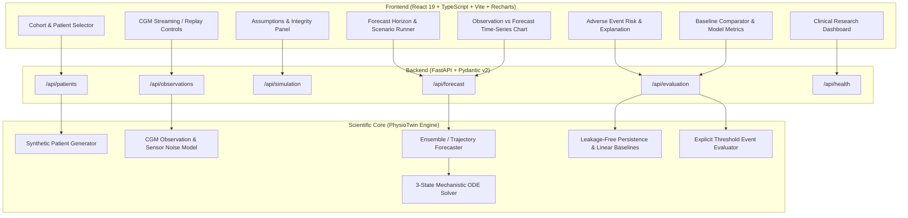

# Full-Stack Implementation Plan: PhysioTwin

**Date:** 2026-10-19  
**Target:** Digital Twin Challenge 2026 Working System Deliverable  
**Stack:** Python FastAPI + SciPy/NumPy Engine | React + TypeScript + Vite + Recharts + Tailwind CSS  

---

## 1. System Architecture



---

## 2. API Contract & Data Models

### 2.1 `/api/health`
- **Method:** `GET`
- **Response:**
  ```json
  {
    "status": "healthy",
    "version": "0.1.0",
    "engine": "physiotwin-reduced-order",
    "timestamp": "2026-10-19T14:00:00Z"
  }
  ```

### 2.2 `/api/patients` & `/api/patients/{patient_id}`
- **Models:**
  - `PatientSummary`: id, name, age, sex, bmi, diabetes_type, hba1c_pct, fasting_glucose_mmol_L, basal_insulin_pmol_L, medications, phenotype_description, parameter_overrides.
  - Distinct synthetic phenotypes:
    1. `SYN-001`: "Baseline Illustrative Adult (config.v1)" — matches `config.v1.json` exactly.
    2. `SYN-002`: "Severe Insulin Resistance" — elevated $S_X^{-1}$, increased basal $HGP_0$, higher fasting glucose.
    3. `SYN-003`: "Impaired Beta-Cell Secretion" — reduced $k_\beta$ and $S_{\beta,0}$, prone to postprandial hyperglycemia.
    4. `SYN-004`: "Well-Controlled T2D on Metformin" — enhanced hepatic insulin sensitivity ($K_H$ lowered), moderate postprandial excursions.

### 2.3 `/api/patients/{patient_id}/observations`
- **Query Params:** `duration_min` (default 360), `sampling_interval_min` (default 5.0), `seed` (int, default 42), `noise_std` (default 0.15 mmol/L).
- **Response:**
  - Array of observations: `timestamp_min`, `cgm_glucose_mmol_L`, `sensor_noise_mmol_L`, `meal_marker_g`, `insulin_bolus_u`, `is_observed=true`.

### 2.4 `/api/simulation/run`
- **Payload:** Patient ID or custom `ModelParameters` + `SolverSettings`.
- **Response:** Complete mechanistic trajectories: $Q_G$, $G$, $I$, $X$, $R_{a,m}$, $HGP$, $R_d$, $S_\beta$, plus conservation residuals and solver diagnostics.

### 2.5 `/api/forecast`
- **Payload:**
  ```json
  {
    "patient_id": "SYN-001",
    "observed_up_to_min": 120.0,
    "forecast_horizon_min": 180.0,
    "meal_scenario": { "amount_mmol": 70.0, "tau_min": 28.0 },
    "uncertainty_level": 0.95
  }
  ```
- **Response:**
  - `observed_segment`: Historical CGM points up to `observed_up_to_min`.
  - `forecast_segment`: Model projection points from `observed_up_to_min` to `observed_up_to_min + forecast_horizon_min`.
  - `confidence_band`: Upper & lower bounds ($p_{0.025}, p_{0.975}$) reflecting parametric/state uncertainty.
  - `model_status`: Diagnostic warnings (e.g. hypothetical closure notice, hypoglycemia risk).

### 2.6 `/api/evaluation/compare`
- **Payload:** Patient ID, split point ($t_{split}$), forecast horizon.
- **Methods Compared:**
  1. **PhysioTwin ODE Twin:** Mechanistic forecast forward from $t_{split}$.
  2. **Persistence Baseline (Zero-Order Hold):** $\hat{G}(t) = G(t_{split})$, strictly no future target leakage.
  3. **Linear Trend Baseline:** Extrapolates recent rate of change ($dG/dt$ over last 15 min), capped.
- **Metrics Calculated on Ground Truth:**
  - RMSE (Root Mean Squared Error, mmol/L)
  - MAE (Mean Absolute Error, mmol/L)
  - Time-in-Range (TIR 3.9 - 10.0 mmol/L, %)
  - Hypoglycemia prediction Brier score and accuracy.

### 2.7 `/api/evaluation/adverse-risk`
- **Explicit Target Definition:**
  - Event: Hypoglycemia ($G(t) < 3.9$ mmol/L) or Severe Hyperglycemia ($G(t) > 13.9$ mmol/L) occurring within the forecast window.
  - Ground Truth: Evaluated on the continuous true simulated trajectory over the forecast horizon.
  - Transparent Calculation: Minimum forecasted glucose, time-to-threshold, hazard probability based on ensemble spread below threshold, and clinical explanation.

---

## 3. Frontend Architecture & Page Structure

### Technology Stack
- **Framework:** React 19 + TypeScript + Vite.
- **Styling:** Modern, clean light-theme CSS with sleek cards, subtle borders, clear clinical color codes (Normal green, Warning amber, Danger red, Accent cyan/blue).
- **Visualization:** Recharts for responsive, interactive dual-line charts with shaded confidence intervals, vertical cursor sync, and zoom/pan.

### Dashboard Layout
1. **Header & Research Disclaimer Banner:**
   - Prominent badge: `DIGITAL TWIN RESEARCH PROTOTYPE — NOT CLINICALLY VALIDATED`.
   - Clear synthetic data indicators.
2. **Left Sidebar / Patient Selector:**
   - Patient cards showing ID, Name, Phenotype, HbA1c, Fasting Glucose, Current Meds.
   - Active patient summary badge.
3. **Primary Time-Series View:**
   - Interactive Recharts visualization.
   - Historical CGM readings (solid circles/line) clearly demarcated from Model Forecast (dashed line + shaded uncertainty band).
   - Vertical dividing line marking Current Time / Forecast Origin ($t_{now}$).
   - Meal events and insulin annotations displayed on the chart axis.
4. **Controls Bar:**
   - Forecast Horizon selector (30m, 60m, 120m, 180m).
   - Replay / Step / Advance Stream controls.
   - Meal disturbance injector (Standard 70 mmol, High Carb 100 mmol, Light Snack 35 mmol).
5. **Right / Lower Analytical Panels:**
   - **Panel A: Adverse Event Risk & Clinical Explanation:**
     - Target: Hypoglycemia ($< 3.9$ mmol/L) within horizon.
     - Predicted probability, expected nadir, time to event.
     - Explanation of mechanistic drivers (e.g. elevated residual insulin action $X$ outlasting meal input).
   - **Panel B: Baseline Comparison & Evaluation:**
     - Comparison table: PhysioTwin vs Persistence vs Linear Extrapolation.
     - Real-time RMSE, MAE, TIR.
   - **Panel C: Physiological Model Assumptions & Limitations:**
     - Status: Phase 1 Reduced-Order Illustrative Engine.
     - Full transparency on the known postprandial dip and uncalibrated parameters.

---

## 4. Vertical Slices & Execution Milestones

### Slice 1: Backend Health & Synthetic Patient Cohort API
- Implement `physiotwin.synthetic` with 4 distinct, documented patient profiles.
- Implement FastAPI app in `src/physiotwin/api/` with `/api/health`, `/api/patients`, `/api/patients/{id}`.
- Pytest API tests using `TestClient` (HTTPX).
- Verify tests pass.

### Slice 2: Time-Series Observations & Streaming API
- Implement synthetic CGM sensor generator with realistic 5-minute sampling and measurement noise ($N(0, \sigma^2)$).
- Add `/api/patients/{id}/observations` endpoint.
- Add test coverage for observation generation and reproducible seeding.

### Slice 3: Simulation & Forecasting API
- Implement `physiotwin.forecast` utilizing the existing 3-state ODE solver.
- Support forecasting from any arbitrary observation cutoff time with ensemble-based parametric uncertainty.
- Expose `/api/forecast` and `/api/simulation/run`.
- Add test coverage for forecast continuity and uncertainty bounds.

### Slice 4: Baseline Comparator & Defensible Risk Evaluation
- Implement leakage-free persistence and linear trend baselines.
- Implement explicit evaluation metrics: RMSE, MAE, Brier score, time-to-event.
- Expose `/api/evaluation/compare` and `/api/evaluation/adverse-risk`.
- Add test coverage verifying no future leakage in baseline calculations.

### Slice 5: Frontend Clinical Research Dashboard
- Initialize Vite React + TypeScript frontend in `frontend/`.
- Build the light-theme UI: Patient selector, Recharts dual-series chart, Stream controls, Risk card, Evaluation metrics, Model assumptions panel.
- Wire frontend to backend API.
- Test frontend build (`npm run build`).

### Slice 6: End-to-End Testing, Documentation, Startup Scripts
- Write integration tests checking end-to-end user workflow: patient selection -> streaming -> forecasting -> baseline evaluation -> risk inspection.
- Update `README.md` with complete developer onboarding, startup commands, and demo script.
- Execute full regression test suite.

---

## 5. Risk Assessment & Mitigation

| Risk | Mitigation |
|---|---|
| Model's known low glucose dip ($1.57$ mmol/L) mistaken for a bug | Explicitly document in UI and API metadata that this is the documented behavior of illustrative closures in `phase1_1_diagnostics.md`, not an error. |
| Target leakage in baseline comparison | Persistence baseline strictly uses $G(t_{split})$ and past points; unit tests verify that ground truth beyond $t_{split}$ is never accessed by baselines. |
| Incompatible Node/Python dependencies | Python 3.14 + FastAPI + Pytest already verified. Node v24 + npm v11 verified. Standalone build without external network dependencies during runtime. |
